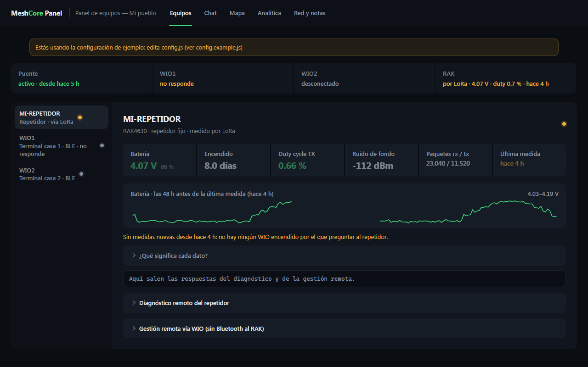
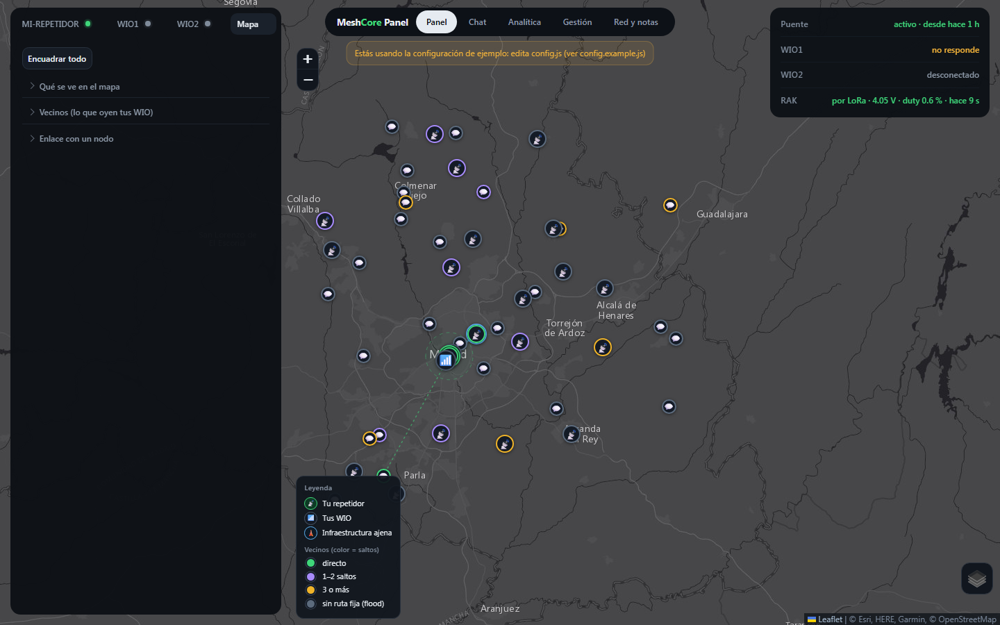
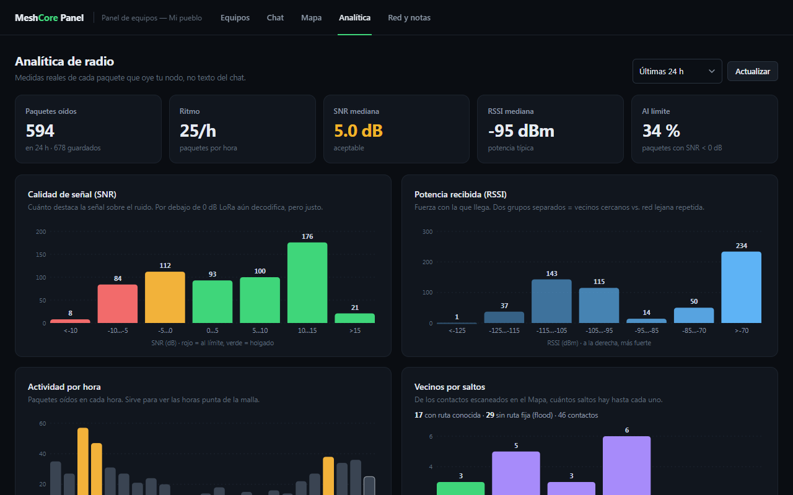
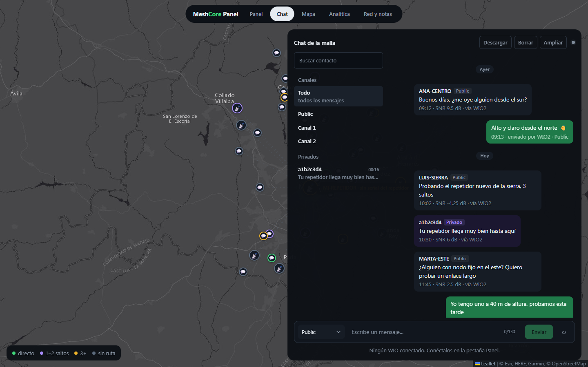

<p align="center">
  
</p>

<h1 align="center">Panel MeshCore</h1>

<p align="center">
  Panel web autoalojado para tu propio equipo <a href="https://meshcore.co.uk">MeshCore</a> LoRa:
  un repetidor y uno o dos companion, desde cualquier navegador (móvil incluido), sin Web Bluetooth.
</p>

<p align="center">
  
  
  
  
</p>

<p align="center"></p>

## Qué hace

| | |
|---|---|
| **📡 Panel** | El mapa con tu repetidor, tus companion y los vecinos por saltos, y encima el estado: batería con tendencia, duty cycle, ruido, paquetes y (opcional) la temperatura de la caja. La Raspberry mide el repetidor por radio cada 15 min aunque nadie tenga el panel abierto. Un WIO apagado se marca «en pausa» y el relay deja de buscarlo |
| **🛡️ Gestión remota** | Login y comandos CLI al repetidor por LoRa, con política de seguridad (bloquea lo destructivo, pide confirmación en lo arriesgado, no deja salirse de la banda legal) y comprobación de legalidad ERC/REC 70-03 |
| **💬 Chat** | Canales y privados, con historial, separadores por día y pantalla completa. Se abre donde lo dejaste («N mensajes nuevos») puedes responder a un mensaje con mención y borrar una conversación, un canal o todo |
| **🗺️ Mapa** (dentro del Panel) | Capas, vecinos por radio, análisis de enlace con perfil de terreno y zona de Fresnel, traceroute, alcance por regiones y exportación a CSV |
| **📊 Analítica** | Cuatro secciones: **Resumen** (cifras con su variación frente al periodo anterior y avisos), **Señal** (SNR, RSSI y señal por hora del día), **Tráfico** (mapa de calor de 7 días, actividad, inundación/directo/duplicados, vecinos) y **Repetidor** (batería, emisión, ocupación del aire y ruido de fondo con sus picos) |
| **🖥️ Terminal** | Terminal web opcional de la Raspberry, tras el mismo login |

<table>
  <tr>
    <td></td>
    <td></td>
    <td></td>
  </tr>
  <tr align="center"><td>Mapa</td><td>Analítica</td><td>Chat</td></tr>
</table>

<sub>Capturas con la configuración y los datos de ejemplo.</sub>

## Cómo funciona

```
navegador ──HTTPS──> nginx (TLS + login) ──> gateway 127.0.0.1:8780 (Raspberry)
                                                   ▲ wss:// con token (nginx, solo la IP del PC)
                                  relay (PC con Bluetooth) ──BLE──> companion 1 / 2
                                                                       │ LoRa
                                                                 tu repetidor
```

- El **navegador no usa Bluetooth**: todo pasa por el gateway de la Raspberry.
- El **relay** corre en un PC con Bluetooth cerca de los companion y es su único dueño.
- El **repetidor** se gestiona por LoRa a través de un companion: no necesita Bluetooth.

Versión actual: **1.32.0** · cambios en [`CHANGELOG.md`](CHANGELOG.md).

## Requisitos

- **Raspberry Pi** con Debian o Raspberry Pi OS (probado en una Pi 4B con Debian 13).
- **Un PC con Bluetooth** cerca de los companion. Probado en Windows. En Linux/macOS el relay
  es el mismo script Python con bleak, pero sin tarea programada: lánzalo a mano (ver paso 4).
- **1 o 2 companion MeshCore** con firmware *companion BLE* (PIN por defecto `123456`).
- **Un repetidor MeshCore**: se gestiona por LoRa a través de un companion, sin Bluetooth.
- **Python 3.11+** en la Pi y en el PC. **Node** solo para pasar los tests.

El preset de radio y las regiones del mapa vienen preparados para la península (Galicia/Portugal);
se cambian en `config.js`.

## Instalación

**1. Raspberry Pi: gateway y token**

```bash
git clone https://github.com/odegaard12/Panel-Meshcore.git
cd panel-meshcore
./bridge/install-pi.sh
```

**2. Panel, terminal, TLS y nginx**

```bash
PANEL_PASS='tu-contraseña' ./deploy/install.sh
```

**3. Tu configuración**

Edita `~/meshcore-panel/www/config.js` (lo crea el instalador a partir de
[`config.example.js`](config.example.js)): nombre y posición de tu repetidor, nombres de tus
companion, infraestructura de referencia de tu zona y tus notas.

**4. PC con Bluetooth: el relay**

Copia el token de la Pi al PC:

```bash
scp usuario@<IP-de-tu-Pi>:~/.meshcore-ble-token ~/.meshcore-ble-token
```

En Windows, desde `bridge/`:

```powershell
.\install-windows.ps1                 # entorno del relay
$env:MESHCORE_GATEWAY_WS = 'wss://<IP-de-tu-Pi>/api/ble/relay'
$env:MESHCORE_GATEWAY_FINGERPRINT = '<huella SHA-256 del certificado de la Pi>'
$env:MESHCORE_WIO1_NAME  = 'nombre-BLE-del-companion-1'
$env:MESHCORE_WIO2_NAME  = 'nombre-BLE-del-companion-2'   # '-' si solo tienes uno
.\instalar-vigilante.ps1              # tarea que lo mantiene vivo
```

En Linux/macOS, a mano (o con tu propio servicio systemd/launchd):

```bash
cd bridge && python3 -m venv .venv && .venv/bin/pip install -r requirements.txt
MESHCORE_BLE_TOKEN="$(cat ~/.meshcore-ble-token)" \
MESHCORE_GATEWAY_WS='wss://<IP-de-tu-Pi>/api/ble/relay' \
MESHCORE_GATEWAY_FINGERPRINT='<huella SHA-256 del certificado de la Pi>' \
MESHCORE_WIO1_NAME='nombre-BLE-del-companion-1' \
MESHCORE_WIO2_NAME='nombre-BLE-del-companion-2' \
.venv/bin/python meshcore_ble_relay.py
```

Empareja antes cada companion con el sistema usando su PIN.

**5. Comprobar**

```bash
curl -s http://127.0.0.1:8780/healthz    # en la Pi: "relay": true y "version"
```

Abre `https://<IP-de-tu-Pi>/` e inicia sesión.

Avisos al móvil (opcional): pon en el servicio del gateway
`MESHCORE_NTFY_URL=https://tu-ntfy/tu-tema` (y `MESHCORE_NTFY_TOKEN` si hace falta)
y te llegará un aviso si la batería del repetidor baja de 3,8 V o si deja de
haber datos durante 3 h.

**El relay entra cifrado y solo desde tu PC.** El gateway escucha solo en la
propia Pi (`MESHCORE_BIND=127.0.0.1`) y el relay llega por nginx con TLS
(`wss://<IP-de-tu-Pi>/api/ble/relay`), comprobando la huella del certificado
autofirmado. Saca la huella en la Pi con
`openssl x509 -in /etc/nginx/meshcore-tls/cert.pem -noout -fingerprint -sha256`.
nginx solo deja pasar la IP de tu PC (`MESHCORE_RELAY_IP=<IP-de-tu-PC>` al
ejecutar `deploy/install.sh` o `deploy/apply-nginx.sh`). **Si cambias de PC**,
vuelve a aplicar nginx con la IP nueva (varias separadas por comas). Fija esa IP
en el router (reserva DHCP) para que no cambie.

Temperatura de la caja (opcional, con Home Assistant): `MESHCORE_HA_URL`,
`MESHCORE_HA_TOKEN`, `MESHCORE_HA_CAJA=sensor.tu_sensor` y, si el repetidor se
alimenta por un enchufe inteligente, `MESHCORE_HA_USB=switch.tu_enchufe`.

**Como app en el móvil.** Abre el panel en el navegador y elige «Añadir a la pantalla de inicio»: queda con su icono y sin barra del navegador. En iPhone funciona con el certificado autofirmado del instalador; en Android, Chrome solo ofrece el acceso directo completo con un certificado de confianza (por ejemplo, desde una VPN como Tailscale o con Let's Encrypt). La app no guarda datos del panel: si no hay conexión muestra un aviso con «Reintentar».

Para no recibir el aviso de «sin datos» (si no tienes el PC siempre encendido):
`MESHCORE_ALERT_STALE_HOURS=0`. El de batería baja sigue activo.

Detalle del montaje, seguridad y diagnóstico: [`deploy/DESPLIEGUE.md`](deploy/DESPLIEGUE.md).

## Problemas comunes

- **El relay no conecta**: en el PC, `Get-NetTCPConnection -RemotePort 8780`. Si sale en
  `CLOSE_WAIT` o hay dos conexiones, tienes dos relays a la vez: deja solo uno.
- **`Insufficient Authentication`**: el companion no está emparejado con PIN. Emparéjalo
  desde el sistema (PIN `123456` si no lo cambiaste).
- **Apps empaquetadas (MSIX, p. ej. Python de la Microsoft Store)**: escriben AppData en una
  copia virtual que el Programador de tareas no ve. Define `MESHCORE_RELAY_DIR` con una ruta
  real antes de `instalar-vigilante.ps1`.
- **El histórico no avanza**: ningún companion está conectado al gateway; mira `healthz`.

- **«Conecta pero no da el servicio de MeshCore»** (en el log del relay, `Characteristic 6e400003… was not found`): Windows guarda los servicios viejos del companion o este está a medio arrancar. Apágalo y enciéndelo; si sigue, quítalo de Configuración → Bluetooth y vuelve a emparejarlo con su PIN.
- **«No empareja con el PIN»**: igual, quítalo del Bluetooth de Windows y vuelve a emparejarlo.
- **El Panel marca el repetidor «sin señal»**: lleva más de una hora sin medirse; casi siempre es que no hay ningún companion conectado por el que preguntarle.

## Privacidad

Tu `config.js` no se sube nunca (está en `.gitignore`): ahí van tus coordenadas, direcciones y
nombres. Antes de proponer cambios, pasa `python tools/check_privado.py`, que falla si encuentra
IP privadas, coordenadas precisas o enlaces de invitación en el repo.

## Pruebas

```bash
PYTHON=bridge/.venv/bin/python bash tools/run-tests.sh
```

## Licencia

MIT. El panel se probó con el preset Portugal/Galicia (869,618 MHz · 62,5 kHz · SF7 · CR6),
pero vale para cualquier preset EU868.
